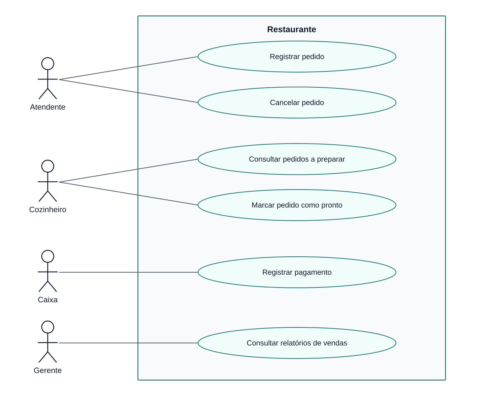
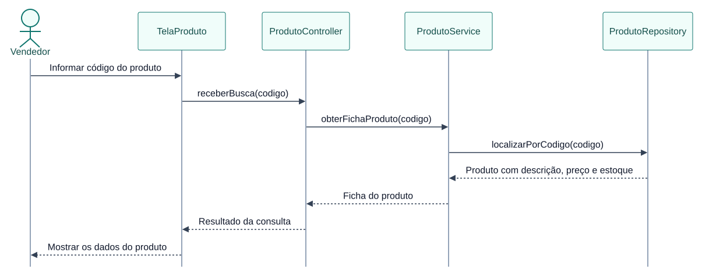
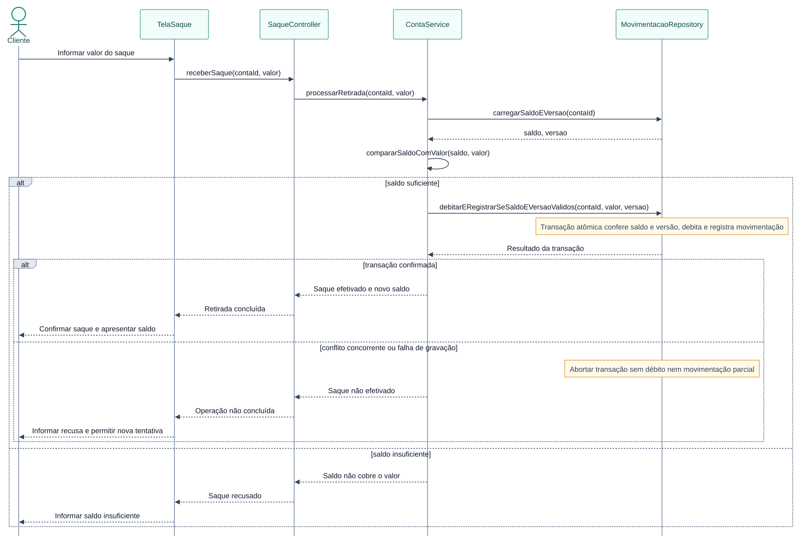
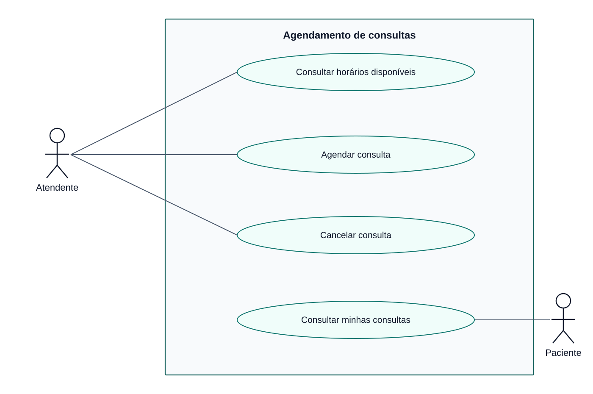
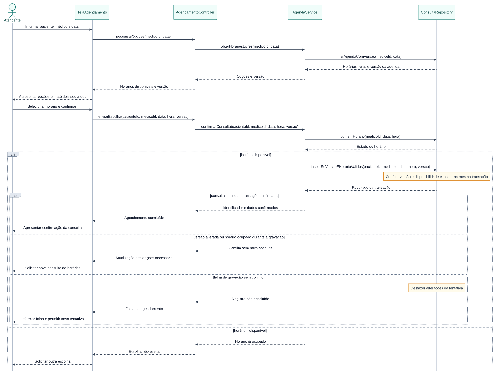

# Atividade 5

## Exercício 1

**a)** Sem um acordo comum, dois desenvolvedores podem entregar soluções incompatíveis para a mesma necessidade. Também há risco de mudanças esquecidas, atrasos, falhas recorrentes e dificuldade para assumir o trabalho de quem saiu.

**b)** Processo de desenvolvimento é a organização do trabalho necessário para produzir software. Define atividades, responsáveis, registros e critérios para acompanhar o que foi combinado e o que foi entregue.

**c) e d)** Estas atividades ajudariam a empresa:

| Atividade | Aplicação e contribuição |
|---|---|
| Planejamento | Definir prioridades, responsáveis e entregas permite acompanhar o andamento e dividir o trabalho. |
| Análise de requisitos | Registrar e confirmar as necessidades com o cliente diminui divergências de interpretação. |
| Projeto | Definir componentes, interfaces e responsabilidades evita que cada pessoa construa uma estrutura diferente. |
| Construção e revisão | Implementar com controle de versão e revisão por outra pessoa compartilha conhecimento e registra mudanças. |
| Testes | Conferir resultados e repetir verificações após mudanças ajuda a encontrar defeitos antes da entrega. |

Os registros devem acompanhar as alterações, permitindo que outra pessoa compreenda o sistema sem depender da memória do desenvolvedor anterior.

## Exercício 2

| Item | Tipo | Justificativa |
|---|---|---|
| a | RN | A validade da habilitação determina quem pode contratar a locação. |
| b | RF | Descreve a ação de registrar uma locação pelo atendente. |
| c | RN | Estabelece o menor período aceito pelo negócio. |
| d | RNF de desempenho | Exige uma resposta dentro do limite de três segundos. |
| e | RF | Solicita uma operação para registrar a devolução. |
| f | RN | Define uma restrição de idade para uma categoria de veículos. |
| g | RNF de segurança | Impõe autenticação como condição de acesso. A funcionalidade de login pode ser especificada separadamente como RF. |

A regra expressa uma condição do negócio. O requisito de software define um comportamento ou uma qualidade exigida do sistema. Por exemplo, impedir a locação com habilitação vencida atende à regra de elegibilidade do cliente.

## Exercício 3

**a)** As regras identificadas são:

| Código | Regra de negócio |
|---|---|
| RN01 | A quantidade de reservas de uma aula deve respeitar sua capacidade. |
| RN02 | O aluno não pode reservar duas aulas no mesmo horário. |
| RN03 | Mensalidade vencida impede novos agendamentos. |

**b) e c)** Os requisitos são:

| Código | Requisito |
|---|---|
| RF01 | Consultar aulas disponíveis. |
| RF02 | Fazer uma reserva de aula. |
| RF03 | Cancelar uma reserva existente. |
| RNF01 | Retornar a consulta de aulas disponíveis em até dois segundos. |

RNF01 é de desempenho: determina a rapidez esperada da consulta.

**d)** RN01 interfere na consulta, que apresenta a disponibilidade, na reserva, que consome uma vaga, e no cancelamento, que libera a vaga. Já RN03 precisa bloquear novos agendamentos; ela não autoriza impedir consultas ou cancelamentos. Assim, uma regra pode orientar várias funções sem receber uma função exclusiva.

## Exercício 4

**a), b) e c)** Os atores e seus objetivos são:

| Ator | Casos de uso |
|---|---|
| Bibliotecário | Efetuar empréstimo; Registrar devolução; Validar acesso. |
| Aluno | Consultar disponibilidade de livros; Consultar próprio histórico; Validar acesso. |
| Coordenador da biblioteca | Cadastrar livro; Bloquear usuário; Validar acesso. |
| Serviço externo de autenticação | Validar acesso. |

**d)** Sim. O serviço é um ator secundário porque fornece uma resposta ao sistema da biblioteca, permanecendo fora dele. Atores representam papéis externos, incluindo sistemas que colaboram com uma operação.

**e)** Clicar, abrir tela e digitar matrícula descrevem ações da interface. O objetivo do usuário é obter um resultado, como consultar seu histórico. Essas ações podem aparecer no fluxo desse caso de uso, mas não costumam constituir objetivos independentes.

## Exercício 5

**a) e b)** Há pelo menos seis problemas: não se identifica o recurso reservado, faltam os dados escolhidos, não se explica a verificação, não se descreve a confirmação, não se informa o registro criado e não se apresenta um resultado final. Essas omissões impedem saber quando o fluxo está correto e o que deve ser testado.

**c)** Faltam objetivo, condições de início e de término, regras e requisitos relacionados e caminhos para indisponibilidade ou falhas. Também é necessário informar entradas e respostas do sistema.

**d)** Adoto como hipótese uma reserva de mesa em restaurante. Data, horário e quantidade de pessoas são informações necessárias neste exemplo, e não requisitos presentes no enunciado original.

| Passo | Fluxo principal proposto |
|---|---|
| P1 | Cliente solicita uma mesa e informa data, horário e quantidade de pessoas. |
| P2 | Sistema consulta e apresenta as opções disponíveis que comportam o grupo. |
| P3 | Cliente escolhe uma opção e informa nome e contato. |
| P4 | Sistema apresenta os dados da reserva para conferência. |
| P5 | Cliente confirma os dados apresentados. |
| P6 | Sistema confere novamente a disponibilidade, registra a reserva e mostra sua identificação, data, horário e quantidade de pessoas. |

## Exercício 6

**UC01: Registrar Reserva**

O objetivo é garantir um quarto para a estadia solicitada pelo cliente. O ator principal é o atendente, que deve ter acesso ao sistema e identificar o cliente antes do registro.

| Etapa | Fluxo principal |
|---|---|
| P1 | Atendente identifica o cliente e informa as datas de entrada e saída. |
| P2 | Sistema valida as datas e verifica se o cliente já possui reserva que coincida com esse período. |
| P3 | Sistema apresenta os quartos disponíveis para a estadia. |
| P4 | Atendente seleciona um quarto e confere o resumo com o cliente. |
| P5 | Atendente confirma o pedido de reserva. |
| P6 | Sistema confere novamente os conflitos, registra a reserva e apresenta seu identificador. |

Após o sucesso, ficam vinculados cliente, quarto e período. Se a operação falhar, nenhuma reserva nova deve ficar registrada.

**Alternativo A1, em P3 ou P6:** sem quarto disponível, o atendente consulta outra combinação de datas e retorna a P2. Se desistir, o caso termina sem registro.

**Alternativo A2, em P2 ou P6:** havendo outra reserva do cliente no mesmo período, o sistema informa o impedimento. Com um período diferente, o atendimento retorna a P2.

**Exceção E1, em P2:** saída igual ou anterior à entrada exige correção das datas e nova validação no próprio passo.

**Exceção E2, em P6:** falha na gravação encerra a tentativa com aviso de que a reserva não foi concluída, desfazendo alterações parciais.

| Relação | Aplicação no caso de uso |
|---|---|
| RF01 | É atendido pelo registro realizado pelo atendente. |
| RN01 | Disponibilidade consultada em P3 e revalidada em P6. |
| RN02 | Saída posterior à entrada, validada em P2. |
| RN03 | Ausência de reservas sobrepostas do cliente, conferida em P2 e P6. |

A RN04 deve ser aplicada em Cancelar Reserva: com exatamente 24 horas de antecedência, o cancelamento ainda é gratuito. O texto não estabelece cobrança para pedidos posteriores.

Para conferir a coerência, podemos testar cada regra com uma situação aceita e outra recusada. Por exemplo, saída no dia seguinte passa na RN02; saída no mesmo dia não passa.

## Exercício 7

| Papel | Objetivos no restaurante |
|---|---|
| Atendente | Registrar pedido e cancelar pedido. |
| Cozinheiro | Consultar pedidos pendentes de preparo e marcar pedido como pronto. |
| Caixa | Registrar pagamento. |
| Gerente | Consultar relatórios de vendas. |

O retângulo representa o limite do software. Cada ator é um papel externo, enquanto os casos de uso representam os resultados que o sistema oferece a esses papéis. As associações indicam participação, sem estabelecer uma sequência entre registrar, preparar e pagar.

## Exercício 8

A interação começa na **TelaProduto**. O **ProdutoController** encaminha o código recebido e organiza a resposta. O **ProdutoService** executa a consulta e recorre ao **ProdutoRepository**, que acessa os dados armazenados.

O resultado volta pelas camadas até o vendedor visualizar o produto. A posição vertical mostra a ordem das mensagens: apresentar os dados antes de recebê-los da consulta seria uma sequência incoerente.

## Exercício 9

O `alt` separa os comportamentos conforme a condição encontrada. Saldo suficiente permite tentar o débito e registrar a movimentação; saldo insuficiente produz uma recusa.

A gravação confere novamente saldo e versão da conta, evitando que duas operações consumam o mesmo valor. Débito e movimentação são confirmados juntos. Conflito ou erro desfaz a tentativa, e o cliente só recebe sucesso após a confirmação da transação.

## Exercício 10

**Regras e requisitos**

| Código | Definição |
|---|---|
| RN01 | A agenda de um médico não pode conter consultas simultâneas no mesmo horário. |
| RN02 | O agendamento depende de o horário escolhido estar disponível. |
| RF01 | Oferecer ao atendente o registro de uma consulta. |
| RF02 | Oferecer ao atendente o cancelamento de uma consulta. |
| RF03 | Mostrar ao paciente suas próprias consultas agendadas. |
| RF04 | Consultar os horários livres de um médico em uma data. |
| RNF01 | Exibir o resultado da consulta de horários disponíveis em até dois segundos. |

RNF01 é de desempenho: estabelece quanto tempo a resposta pode levar.

**Caso de uso: Agendar Consulta**

O atendente realiza o registro em nome do paciente. O objetivo é assegurar uma consulta com o médico, a data e o horário escolhidos pelo paciente e comunicados ao atendente. Antes de começar, paciente e médico precisam estar identificados e o atendente deve ter acesso à operação.

| Etapa | Fluxo principal |
|---|---|
| P1 | Atendente informa o paciente, o médico e a data solicitada. |
| P2 | Sistema consulta a agenda e mostra os horários livres em até dois segundos. |
| P3 | Atendente informa o horário escolhido pelo paciente. |
| P4 | Sistema recebe a confirmação com paciente, médico, data e horário. |
| P5 | Sistema revalida o horário e grava a consulta, impedindo ocupação simultânea. |
| P6 | Sistema apresenta o identificador e os dados da consulta. |

**Alternativo A1, em P5:** horário ocupado impede o registro. O atendente volta a P2 para escolher outra opção, ou encerra sem agendar.

**Exceção E1, em P5:** falha de gravação desfaz a operação e informa que a consulta não foi registrada. Uma nova tentativa começa em P2.

No sucesso, existe uma consulta confirmada para o paciente. Nos demais resultados, nenhuma consulta nova é mantida. RF01 e RF04 sustentam o fluxo; RN01 e RN02 condicionam P5.

O atendente registra e cancela consultas, além de consultar horários. O paciente acessa suas próprias consultas agendadas.

O serviço recebe a versão consultada da agenda. O repositório só registra se essa versão continuar válida e o horário permanecer livre, na mesma transação. Uma alteração concorrente exige nova consulta. A tela apresenta sucesso somente após a gravação confirmada.

| Artefato | Pergunta respondida |
|---|---|
| Regra de negócio | Que condição determina se a operação é permitida? |
| Requisito | Qual função ou condição de qualidade o software deve entregar? |
| Caso de uso | Que interação leva o ator ao resultado esperado? |
| Diagrama de casos de uso | Quais papéis participam de cada objetivo do sistema? |
| Diagrama de sequência | Quem envia cada mensagem e em que momento do cenário? |

[Enunciado utilizado](https://github.com/JoaoChoma/analise_projeto_esoft_2026/blob/main/atividades/1_bim/atividade05_revisao_master_class.md)
