# Atividade 6

Matheus Lara Campos, RA 126608

## Exercício 1

**a)** O Diagrama de Casos de Uso delimita os serviços oferecidos pelo sistema e os atores que buscam resultados por meio deles.

**b)** O Diagrama de Sequência descreve a colaboração entre participantes durante uma execução, indicando mensagens e sua ordem.

**c)** O Diagrama de Classes organiza os tipos de objetos, seus dados, comportamentos e vínculos estruturais.

**d)** Uma sequência pode omitir atributos, visibilidade, generalizações, multiplicidades e associações que não participam daquele cenário.

**e)** Um caso de uso identifica o objetivo, a sequência distribui as interações necessárias e o modelo de classes registra a estrutura capaz de realizá-las. Conhecer uma execução não substitui conhecer essa estrutura.

## Exercício 2

| Classe | Atributos | Operações propostas | Responsabilidade |
|---|---|---|---|
| Livro | `codigo: Long`, `titulo: String`, `isbn: String` | `corrigirDados(titulo, isbn)` | Descrever a obra, independentemente das cópias físicas. |
| Exemplar | `numeroPatrimonio: String`, `situacao: SituacaoExemplar` | `emprestar()`, `devolver()` | Controlar a situação de uma cópia. |
| Aluno | `ra: String`, `nome: String` | `alterarNome(nome)` | Identificar o usuário responsável pelos empréstimos. |
| Emprestimo | `numero: Long`, `retiradoEm: LocalDate`, `devolucaoPrevista: LocalDate`, `devolvidoEm: LocalDate` opcional | `finalizar(data)`, `estaAtrasado(hoje)` | Manter as datas e o encerramento de cada empréstimo. |

Um `Livro` pode ter nenhum ou vários exemplares; cada `Exemplar` corresponde a um livro. `Aluno` e `Exemplar` podem participar de vários empréstimos históricos, mas cada `Emprestimo` identifica exatamente um aluno e um exemplar. O mesmo exemplar não pode ter dois empréstimos em aberto ao mesmo tempo.

Substantivos são candidatos, não uma regra automática de identificação. A data prevista é um atributo de `Emprestimo`, por exemplo. A criação de uma classe depende da necessidade de representar identidade, estado ou responsabilidade própria.

## Exercício 3

| Item | Resposta |
|---|---|
| a | Os compartimentos contêm o nome, os atributos e as operações da classe. |
| b | Atributos descrevem o estado de uma instância; operações expressam o que ela pode fazer. |
| c | `+` significa acesso público; `-`, acesso privado. |
| d | Indica o tipo de um dado ou do retorno. `quantidade: Integer` é inteiro; `verificarEstoque(qtd): Boolean` devolve um resultado lógico. |
| e | As operações registram o contrato e as responsabilidades da classe, necessários para entender sua colaboração com outras classes. |
| f | Restringir a visibilidade protege a representação interna. O encapsulamento também exige operações que impeçam estados inválidos; apenas criar campos privados e setters não garante isso. |

## Exercício 4

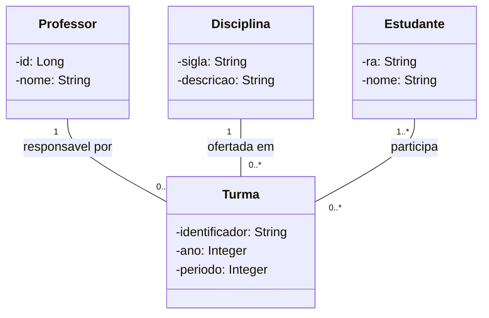

O diagrama representa turmas com pelo menos um estudante. Um estudante pode estar sem turma, enquanto professor e disciplina podem existir sem ofertas naquele período. Cada turma possui uma disciplina e um professor responsável.

| Multiplicidade | Leitura |
|---|---|
| `1` | Exige uma única instância. |
| `0..1` | Admite ausência ou uma instância. |
| `0..*` | Permite uma coleção vazia ou com vários elementos. |
| `1..*` | Exige uma coleção com pelo menos um elemento. |

Esses limites orientam a escolha de referências e coleções e as validações de cadastro. No código, uma `List` não assegura sozinha o limite mínimo ou a ausência de duplicações.

## Exercício 5

**a)** A representa agregação, B representa composição e C representa associação.

**b)** Associação descreve uma ligação entre objetos. Agregação acrescenta a ideia de um todo cujas partes conservam existência independente. Composição representa partes exclusivas, cujo vínculo e ciclo de vida são controlados pelo todo.

**c)** A destruição do composto implica a destruição das partes que ainda lhe pertencem. Se houver persistência, a aplicação precisa assegurar essa regra também no banco.

**d)** Uma referência não prova propriedade nem dependência de existência. Usar composição sem essas condições comunicaria uma restrição que o domínio não possui.

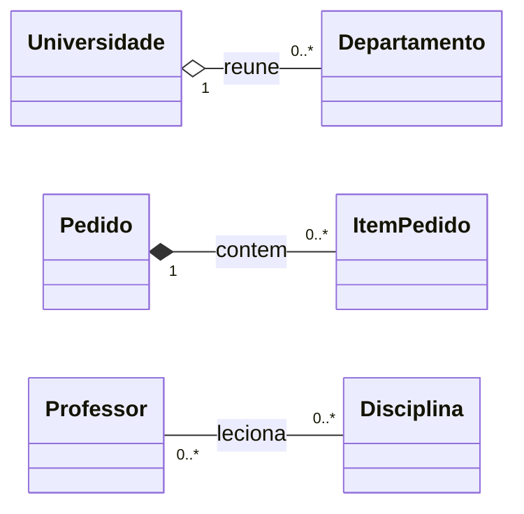

Considerei cada departamento vinculado a uma universidade por vez; uma transferência altera esse vínculo, preservando o departamento. Um item não é compartilhado por pedidos e não tem finalidade fora do seu pedido. Ministrar uma disciplina não torna o professor proprietário dela.

## Exercício 6

**a)** A classe geral contém `identificador`, `valor`, `data` e `situacao`.

**b)** A validação do valor, a consulta da situação e a atualização do resultado do pagamento podem ter implementação comum.

**c)** Pix utiliza código de cobrança, cartão precisa de autorização e boleto possui vencimento e identificação de cobrança. A operação de processamento varia conforme a modalidade.

**d)**

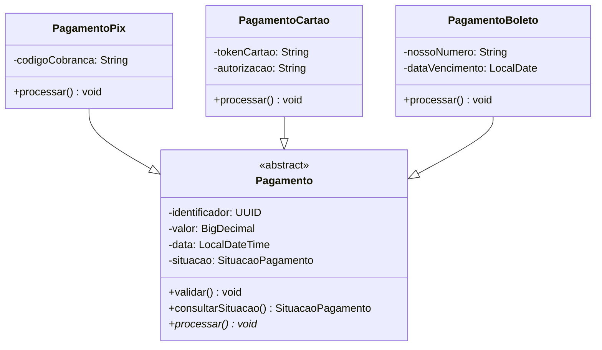

**e)** Na herança, a classe especializada deve poder substituir a classe geral. Na composição, um objeto usa partes sob sua propriedade para cumprir suas responsabilidades, sem se tornar um subtipo delas.

**f)** Hierarquias rígidas dificultam mudanças quando as especializações combinam características diferentes ou precisam desrespeitar o comportamento herdado. Compartilhar código, isoladamente, não justifica criar uma relação de herança.

## Exercício 7

**a)** `Pedido` deve controlar seus itens, a situação e as alterações permitidas pelo negócio.

**b)** `PedidoService` organiza a execução de uma solicitação: recupera o pedido, chama o domínio e solicita a gravação.

**c)** O cálculo do total, o cancelamento e a aplicação de um desconto válido podem ser operações de `Pedido`.

**d)** Regras espalhadas em uma Service permitem que outras partes alterem os dados sem respeitá-las. Uma Service central também exige mudanças e testes envolvendo assuntos demais.

**e)** A proposta coloca as invariantes no pedido e separa a verificação da política comercial, que pode envolver informações externas ao próprio pedido.

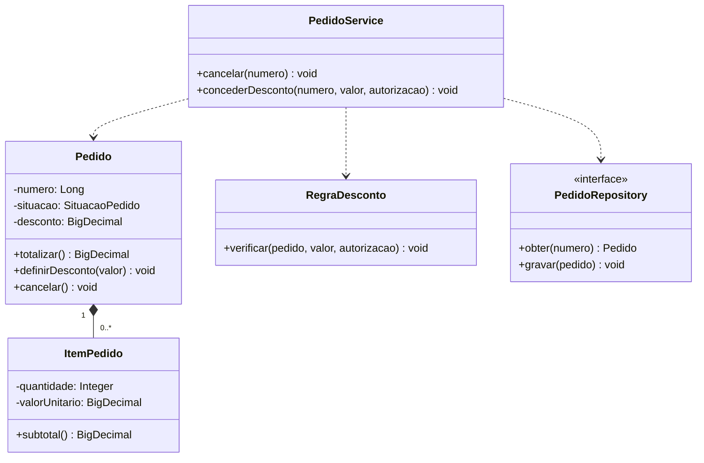

`Pedido.definirDesconto()` preserva os limites do valor e `cancelar()` verifica a situação atual. A regra comercial decide se a concessão é autorizada; a aplicação coordena essa decisão e a persistência.

## Exercício 8

**a)** A classe reúne operações de cadastros, logística, pagamento, segurança e comunicação. São motivos de mudança diferentes dentro do mesmo componente.

**b)** Coesão mede o quanto os elementos de uma classe contribuem para um mesmo propósito.

**c)** Acoplamento expressa quanto uma classe precisa conhecer ou usar outras partes do sistema.

**d)** Responsabilidades misturadas ampliam o impacto de uma alteração e obrigam os testes a preparar dependências que não interessam ao comportamento avaliado.

**e) e f)**

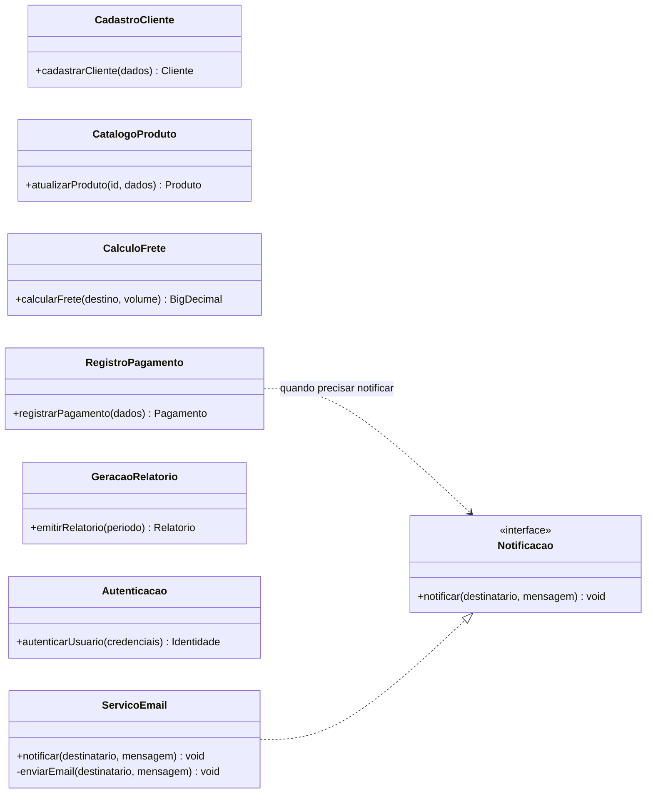

O contrato de notificação permite trocar o mecanismo de envio sem alterar o registro do pagamento. Os demais componentes passam a ter finalidades próprias, sem uma classe que concentre todas as regras.

## Exercício 9

**a)** Tela, controlador e serviço podem corresponder a classes da implementação. O repositório pode ser uma interface. O cliente do diagrama pode ser somente o ator que inicia a interação.

**b)** A tela apresenta e coleta dados; o controlador adapta a entrada; o serviço coordena o registro; `Pedido` representa o negócio; o adaptador de repositório executa o acesso técnico aos dados.

**c)** Como a descrição apresenta apenas a cadeia de participantes, proponho as operações `enviar(dados)`, `registrar(dados)`, `executar(dados)` e `gravar(pedido)`.

**d)** Mensagens com quantidades, identificadores e valores ajudam a descobrir dados necessários. Atributos definitivos também dependem das regras e da análise do domínio, não apenas das mensagens desse cenário.

**e)**

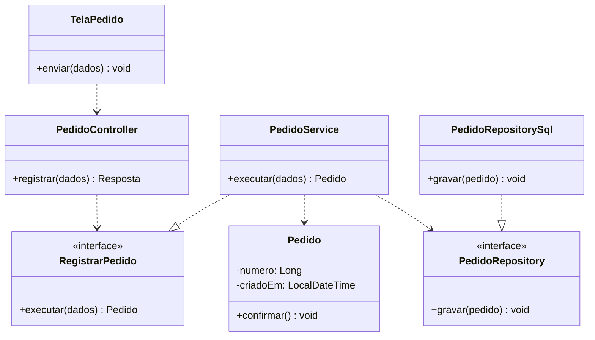

**f)** O modelo de domínio trata dos conceitos e regras do negócio. Interfaces gráficas, protocolos e adaptadores são detalhes de outras partes do projeto, embora também apareçam nas sequências.

## Exercício 10

| Responsabilidade | Classificação |
|---|---|
| 1. Receber HTTP | Apresentação/Interface. |
| 2. Validar regras comerciais | Domínio. |
| 3. Coordenar um caso de uso | Aplicação. |
| 4. Consultar o banco | Infraestrutura. |
| 5. Representar uma entidade | Domínio. |
| 6. Converter a entrada recebida | Apresentação, na leitura do HTTP para DTO. A criação do objeto de domínio é encaminhada à aplicação. |
| 7. Gravar alterações | Infraestrutura, atendendo a uma solicitação por contrato. |
| 8. Produzir resposta HTTP | Apresentação/Interface. |

**a) e b)**

| Camada | Finalidade | Classes possíveis |
|---|---|---|
| Apresentação | Traduzir ações externas para a aplicação e apresentar resultados. | `ProdutoController`, `NovoProdutoRequest`. |
| Aplicação | Executar a sequência de trabalho de cada caso de uso. | `ProdutoService`, `RegistrarPedido`. |
| Domínio | Manter os conceitos, comportamentos e contratos ligados ao negócio. | `Produto`, `Pedido`, `PedidoRepository`. |
| Infraestrutura | Conectar a solução ao banco e a serviços técnicos. | `ProdutoRepositoryJdbc`, adaptador de e-mail. |

**c)** Uma camada é uma divisão de responsabilidades. Uma pasta é uma forma de armazenar os arquivos; ela pode representar uma camada ou conter um módulo com várias responsabilidades internas.

**d)** Quatro camadas lógicas não obrigam quatro pastas na raiz do projeto.

**e)** O isolamento permite testar regras sem HTTP ou banco e substituir um adaptador com menor interferência no restante do sistema.

## Exercício 11

| Item | Resposta |
|---|---|
| a | `ProdutoController` adapta a comunicação; `ProdutoService` executa o caso de uso; `Produto` mantém estado e regras; `ProdutoRepository` declara como obter e gravar produtos. |
| b | O controlador recebe a requisição HTTP. |
| c | O serviço de aplicação coordena a operação solicitada. |
| d | A entidade `Produto` representa o conceito do domínio. |
| e | O contrato de repositório oferece as operações de dados, e sua implementação realiza o acesso ao banco. |
| f | A entidade precisa funcionar mesmo quando a entrada não vier de HTTP. Depender do controlador inverteria essa independência. |

**g)** Nesta proposta, o contrato de repositório fica no domínio e a implementação fica na infraestrutura.

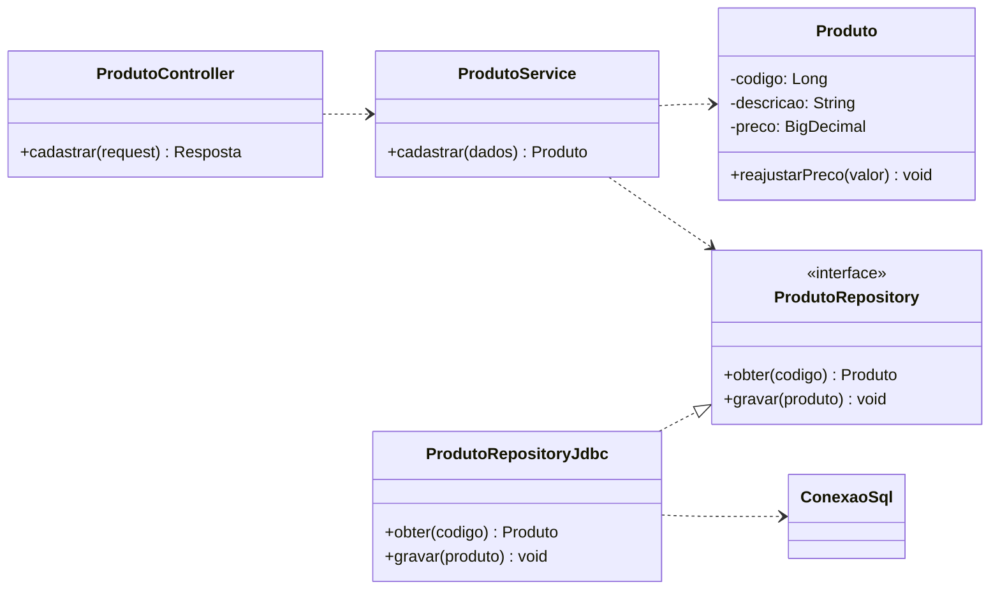

## Exercício 12

**a)** O controlador tem mais de um motivo de mudança: transporte HTTP, preço, desconto e estoque. Isso dificulta reutilizar as regras por outra interface e testar o negócio sem preparar requisições.

**b)** O acesso direto pode ser aceitável em consultas ou operações simples, conforme a arquitetura adotada. Ele não justifica colocar regras comerciais no controlador nem expor detalhes do banco.

**c)** O controlador encaminha a operação ao serviço. O serviço obtém os objetos por contratos, solicita validações do domínio e organiza a gravação.

**d)** A entidade controla os limites de estoque e preço. Uma política de precificação pode calcular condições comerciais que envolvem mais informações.

**e)** Autorização da operação, coordenação das chamadas e limite da transação são responsabilidades de aplicação.

**f)**

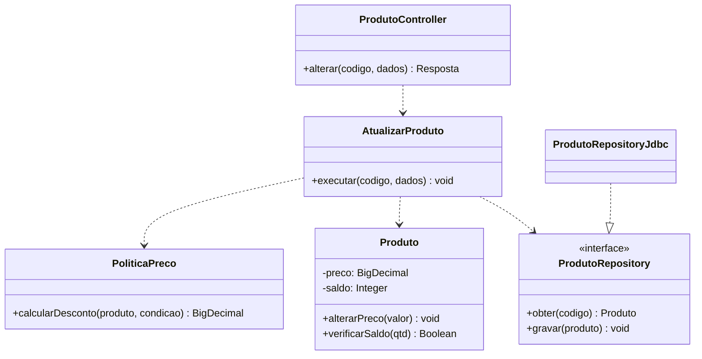

## Exercício 13

**a)** A pasta única dificulta identificar quais arquivos pertencem ao mesmo assunto e quais podem depender de outros. A busca por nomes passa a substituir uma organização explícita.

**b)** Por camadas:

```text
src/main/java/sistema/
  apresentacao/
    ClienteController.java
    ProdutoController.java
    PedidoController.java
  aplicacao/
    ClienteService.java
    ProdutoService.java
    PedidoService.java
  dominio/
    Cliente.java
    Produto.java
    Pedido.java
    repositorio/
      ClienteRepository.java
      ProdutoRepository.java
      PedidoRepository.java
  infraestrutura/
    ClienteRepositoryJdbc.java
    ProdutoRepositoryJdbc.java
    PedidoRepositoryJdbc.java
```

**c)** Por funcionalidades:

```text
src/main/java/sistema/
  cliente/
    web/ClienteController.java
    aplicacao/ClienteService.java
    dominio/Cliente.java
    dominio/ClienteRepository.java
    persistencia/ClienteRepositoryJdbc.java
  produto/
    web/ProdutoController.java
    aplicacao/ProdutoService.java
    dominio/Produto.java
    dominio/ProdutoRepository.java
    persistencia/ProdutoRepositoryJdbc.java
  pedido/
    web/PedidoController.java
    aplicacao/PedidoService.java
    dominio/Pedido.java
    dominio/PedidoRepository.java
    persistencia/PedidoRepositoryJdbc.java
```

**d)** A primeira estrutura destaca os papéis técnicos e facilita comparar classes semelhantes. A segunda aproxima os arquivos alterados juntos em uma funcionalidade, mas exige controlar a comunicação entre módulos.

**e)** A segunda permite começar pelo módulo `pedido` para localizar o registro de pedidos.

**f)** Em um sistema médio, adotaria a organização por funcionalidades com os papéis internos indicados. Ela dá uma unidade de manutenção para cada assunto e evita perder a separação entre regra, coordenação e persistência.

## Exercício 14

| Item | Resposta |
|---|---|
| a | A usa o tipo de responsabilidade técnica como critério. B usa o conceito de negócio atendido. |
| b | A torna as camadas evidentes, mas distribui uma alteração funcional por várias pastas. B reúne o trabalho da funcionalidade, mas pode ocultar responsabilidades se todos os arquivos forem misturados no módulo. |
| c | A comunica primeiro a tecnologia da solução; B comunica primeiro os assuntos que o sistema atende. |
| d | As pastas não impedem chamadas inadequadas, ciclos ou classes com responsabilidades demais. Portanto, não garantem boa arquitetura. |
| e | Cada módulo pode conter `web`, `aplicacao`, `dominio` e `persistencia`. Interfaces públicas definem sua comunicação e implementações internas permanecem encapsuladas. |

## Exercício 15

Adotei RN01, RF01 e UC01 com os significados fornecidos no exercício 16.

| Campo | Documentação |
|---|---|
| Classe | `PedidoService`. |
| Responsabilidade | Conduzir o registro do pedido, verificando disponibilidade antes de confirmar e gravar. |
| Operação pública | `registrarPedido(Pedido pedido): void`. |
| Parâmetro | Pedido a registrar, com cliente e produtos informados. |
| Resultado esperado | Pedido registrado com confirmação válida; a operação não devolve um valor pela assinatura apresentada. |
| Erros previstos | Dados inconsistentes, produto indisponível ou falha de gravação. Uma falha não deve deixar confirmação parcial. |
| Dependências | Contratos `PedidoRepository` e `ProdutoRepository`, entidades e controle de transação. |
| RN relacionada | RN01: impedir confirmação com produto indisponível. |
| RF relacionado | RF01: disponibilizar o registro de pedidos. |
| UC relacionado | UC01: Registrar Pedido. |

A documentação da classe trata de uma unidade da implementação. A documentação do caso de uso descreve a interação necessária para atingir o objetivo do ator, podendo envolver várias classes.

## Exercício 16

```text
RN01: bloquear confirmação com produto indisponível
  -> RF01: registrar pedidos
  -> UC01: Registrar Pedido
  -> consultar produtos e verificar quantidades
  -> Produto.possuiEstoque(qtd)
  -> Pedido.confirmar()
  -> PedidoRepository.gravar(pedido)
  -> módulos pedido e produto, com contratos no domínio
```

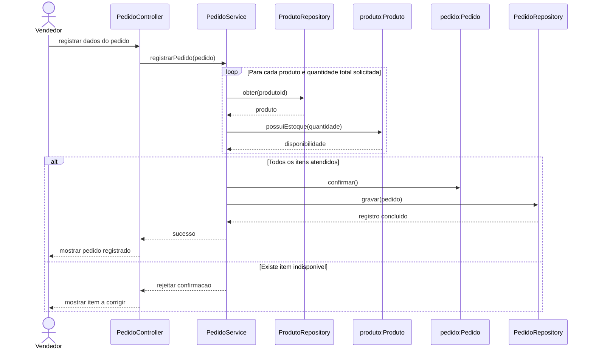

**a)** As entidades necessárias são `Pedido`, `ItemPedido` e `Produto`. Controlador, serviço e contratos de repositório completam a colaboração técnica.

**b)** `Produto.possuiEstoque()` avalia a quantidade disponível. `PedidoService` reúne os resultados de todos os produtos e impede a continuação se algum falhar.

**c)** `Pedido` modifica sua situação por `confirmar()`, chamado pela aplicação no caminho válido.

**d)** O fragmento `alt` impede a mensagem de confirmação e a gravação quando a condição de estoque não é atendida.

**e)** A documentação relaciona RN01 ao método de disponibilidade e à coordenação do UC01. Os testes devem demonstrar os dois caminhos do `alt`. Na implementação concorrente, leitura protegida, comprometimento do estoque e gravação precisam compartilhar uma transação, para não depender de uma consulta já desatualizada.

## Exercício 17

**a) e b)**

| Classe | Atributos | Operações |
|---|---|---|
| Produto | `codigo`, `descricao`, `unidade` | `alterarDescricao()`. |
| EstoqueProduto | `saldo`, `versao` | `entrar(qtd, responsavel)`, `sair(qtd, responsavel)`, `consultarSaldo()`. |
| Movimentacao | `numero`, `tipo`, `quantidade`, `instante` | `consultarRegistro()`. |
| Usuario | `identificador`, `nome` | `obterIdentificador()`. |
| TipoMovimento | `ENTRADA`, `SAIDA` | Enumeração. |

**c) e d)**

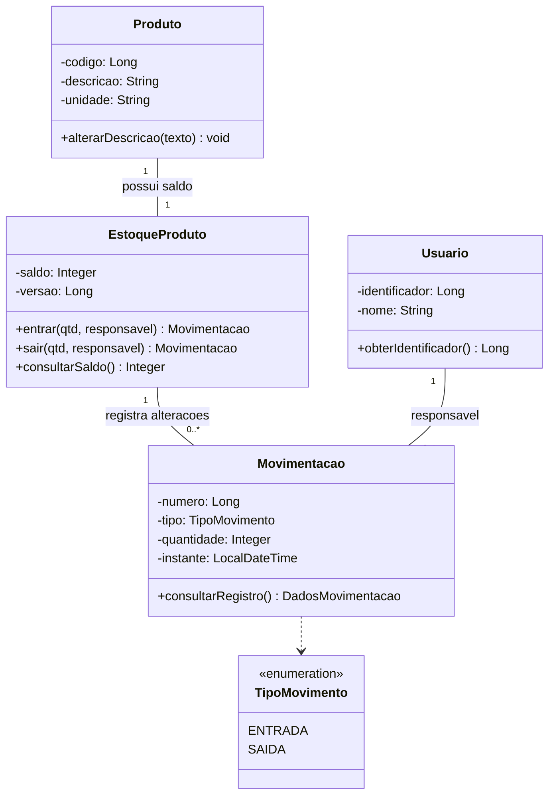

O produto é cadastrado com saldo inicial zero. Cada movimentação identifica um único saldo e um único responsável. A quantidade da entrada ou saída deve ser positiva.

**e)** `CadastroProduto`, `RegistrarMovimentacao`, `ConsultarEstoque` e `EmitirRelatorio` coordenam as funcionalidades. O registro consulta a autorização do usuário antes de chamar o domínio.

**f)** Repositórios SQL, adaptador de autorização, controle transacional e controle de versão pertencem à infraestrutura. O domínio não executa SQL nem interpreta credenciais HTTP.

**g)**

```text
src/main/java/br/edu/sistema/
  estoque/
    web/
      EstoqueController.java
      MovimentacaoRequest.java
    aplicacao/
      CadastroProduto.java
      RegistrarMovimentacao.java
      ConsultarEstoque.java
      EmitirRelatorio.java
      Autorizacao.java
    dominio/
      Produto.java
      EstoqueProduto.java
      Movimentacao.java
      TipoMovimento.java
      ProdutoRepository.java
      MovimentacaoRepository.java
    infraestrutura/
      ProdutoRepositoryJdbc.java
      MovimentacaoRepositoryJdbc.java
      AutorizacaoAdapter.java
      TransacaoSql.java
  identidade/
    Usuario.java
```

**h)**

| Regra | Ponto de aplicação |
|---|---|
| RN01 | `EstoqueProduto.sair()` recusa quantidade maior que o saldo. Atualizações concorrentes são verificadas por versão na mesma transação. |
| RN02 | `entrar()` produz o registro de entrada; o caso de uso grava o novo saldo e a movimentação juntos. |
| RN03 | `sair()` produz o registro de saída; se uma das gravações falhar, a transação desfaz a operação inteira. |
| RN04 | `RegistrarMovimentacao` exige a permissão necessária por `Autorizacao`, usando a identidade já autenticada. |

## Exercício 18

### Etapa 1

| RF | Funcionalidade |
|---|---|
| RF01 | Abrir e registrar um pedido para um cliente cadastrado. |
| RF02 | Cadastrar clientes. |
| RF03 | Cadastrar produtos. |
| RF04 | Consultar produtos e suas quantidades disponíveis. |
| RF05 | Adicionar produtos e quantidades ao pedido em rascunho. |
| RF06 | Calcular subtotais e total, aplicando somente desconto autorizado. |
| RF07 | Confirmar o pedido depois de validar suas condições. |
| RF08 | Cancelar um pedido que ainda não foi enviado. |
| RF09 | Consultar o histórico de pedidos do cliente. |

| RNF proposto | Condição a validar com a empresa |
|---|---|
| RNF01. Segurança | Operações de alteração devem verificar a identidade e as permissões do operador. |
| RNF02. Consistência | Confirmação do pedido e atualização do estoque devem concluir juntas ou ser desfeitas integralmente. |
| RNF03. Concorrência | Confirmações simultâneas não podem comprometer o mesmo saldo nem confirmar duas vezes o mesmo pedido. |
| RNF04. Desempenho | Pelo menos 95% das consultas de catálogo devem responder em até dois segundos com 80 usuários simultâneos. |

| Ator | Casos de uso propostos |
|---|---|
| Vendedor | UC01 Registrar Pedido; UC02 Cancelar Pedido; UC03 Cadastrar Cliente; UC05 Consultar Catálogo; UC06 Consultar Histórico. |
| Administrador do catálogo | UC04 Cadastrar Produto e UC05 Consultar Catálogo. |

Os perfis e os limites de desempenho são propostas de análise. Adicionar itens, calcular e confirmar são comportamentos de UC01. A autorização comercial do desconto é verificada durante esse fluxo, conforme a política acordada.

### Etapa 2

| Campo | UC01: Registrar Pedido |
|---|---|
| Objetivo | Compor e confirmar um pedido com cliente, itens e valores válidos. |
| Ator | Vendedor. |
| Pré-condições | Operador autorizado e cliente cadastrado; produtos disponíveis para consulta. |
| Pós-condição de sucesso | Pedido confirmado e gravado, com estoque comprometido para os itens confirmados. |
| Garantia em falha | O rascunho pode continuar disponível para correção, mas não há confirmação nem baixa parcial de estoque. |
| RF relacionados | RF01, RF04, RF05, RF06 e RF07. |
| RN relacionadas | RN01, RN02, RN03, RN04 e RN05. RN06 é aplicada em UC02, Cancelar Pedido. |

Nesta proposta, o pedido recebe um número e é salvo como rascunho antes da confirmação. O estoque só é comprometido quando o vendedor confirma.

| Passo | Fluxo principal |
|---|---|
| 1 | O vendedor informa o cliente para abrir um pedido. |
| 2 | O sistema confere o cliente e registra o rascunho. |
| 3 | O vendedor escolhe um produto e informa a quantidade. |
| 4 | O sistema confere o estoque para a quantidade acumulada daquele produto e adiciona o item ao rascunho. |
| 5 | O vendedor repete a inclusão para os demais produtos. |
| 6 | O sistema apresenta subtotais, desconto autorizado e total. |
| 7 | O vendedor solicita a confirmação. |
| 8 | Em uma transação, o sistema revalida o pedido, protege o saldo concorrente, compromete o estoque e muda a situação para confirmado. |
| 9 | A gravação é concluída e o sistema apresenta o número e o total do pedido. |

| Alternativa ou exceção | Resultado |
|---|---|
| A1. Cliente inexistente | Não abrir o pedido e pedir a identificação de um cliente cadastrado. |
| A2. Produto indisponível ou quantidade inválida | Não incluir o item; permitir escolher outra quantidade ou produto. |
| A3. Desconto sem autorização ou fora dos limites | Recusar o desconto e manter o cálculo anterior. |
| A4. Pedido sem itens | Manter o rascunho e impedir a confirmação. |
| A5. Desistência | Encerrar pelo cancelamento do rascunho, sem baixa de estoque. |
| E1. Saldo mudou ou pedido foi alterado por outra operação | Desfazer a confirmação, atualizar os dados apresentados e solicitar revisão. |
| E2. Banco indisponível ou falha no commit | Desfazer os efeitos transacionais e informar que a confirmação não ocorreu. |

### Etapa 3

**Abertura e inclusão dos itens.**

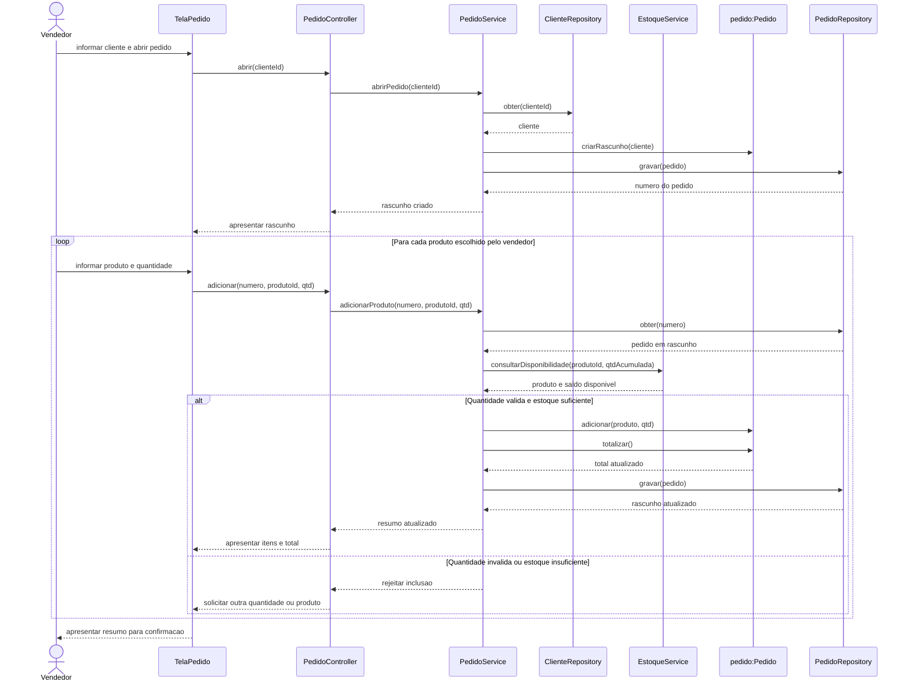

**Confirmação e persistência.**

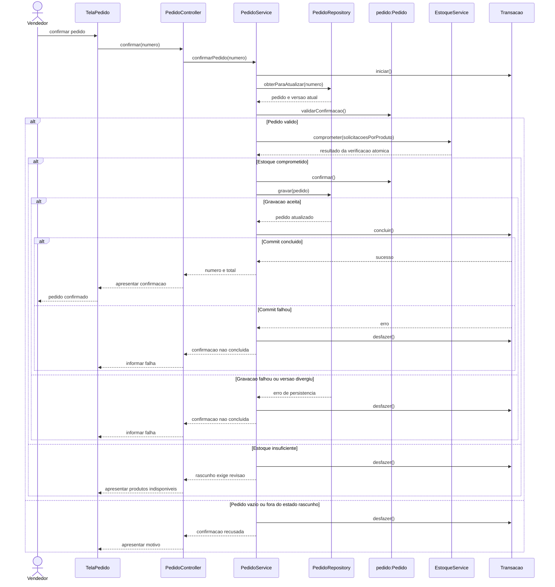

O primeiro diagrama apresenta o caminho de cliente válido; A1 encerra a abertura antes da criação do rascunho. A autorização do desconto deve ser verificada antes de gravá-lo e novamente antes da confirmação. As inclusões e alterações de desconto são gravadas em transações curtas, com controle de versão do pedido. A confirmação usa a mesma transação para estoque e pedido, sem manter uma transação aberta enquanto o vendedor escolhe os itens.

### Etapa 4

| Classe ou interface | Responsabilidade | Dados ou dependências | Operações principais |
|---|---|---|---|
| Cliente | Representar quem realiza a compra. | `codigo`, `nome`. | `alterarDados()`. |
| Produto | Representar o item do catálogo e seu preço. | `codigo`, `descricao`, `preco`. | `alterarPreco()`. |
| EstoqueProduto | Manter o saldo e proteger seus limites. | `disponivel`, `versao`. | `atende()`, `comprometer()`, `recompor()`. |
| Pedido | Controlar o rascunho e as transições permitidas. | `numero`, `cliente`, `criadoEm`, `situacao`, `versao`, `desconto`. | `adicionar()`, `definirDesconto()`, `totalizar()`, `validarConfirmacao()`, `confirmar()`, `cancelar()`. |
| ItemPedido | Guardar quantidade e preço aplicado. | `produto`, `quantidade`, `valorUnitario`. | `subtotal()`. |
| SituacaoPedido | Definir os estados do pedido. | `RASCUNHO`, `CONFIRMADO`, `ENVIADO`, `CANCELADO`. | Enumeração. |
| PoliticaDesconto | Verificar condições e autorização comercial. | Contexto comercial e autorização apresentada. | `validar()`. |
| GestaoPedidos | Expor as operações de aplicação para a interface. | Contrato de entrada. | `abrirPedido()`, `adicionarProduto()`, `definirDesconto()`, `confirmarPedido()`, `cancelarPedido()`, `consultarHistorico()`. |
| PedidoService | Implementar os casos de uso de pedidos. | Repositórios, estoque, política e transação. | Implementar `GestaoPedidos`. |
| EstoqueService | Coordenar o acesso ao saldo para os casos de uso. | `ProdutoRepository` e solicitações por produto. | `consultarDisponibilidade()`, `comprometer()`, `estornar()`. |
| PedidoController e TelaPedido | Adaptar a entrada e apresentar resultados. | Contrato de aplicação e DTOs. | Abrir, adicionar, confirmar, cancelar e consultar. |
| ClienteService e ProdutoService | Coordenar os cadastros e as consultas dos respectivos módulos. | Contratos de repositório. | `cadastrar()`, `consultar()`. |
| ClienteRepository, ProdutoRepository e PedidoRepository | Declarar acesso às entidades. | Interfaces localizadas nos módulos de domínio. | Obter, consultar e gravar; o contrato de pedido também permite obter com proteção de atualização. |
| Implementações Jdbc | Traduzir os contratos para operações de banco. | Conexão e mapeamento SQL. | Implementar os repositórios. |
| Transacao | Delimitar o trabalho atômico da aplicação. | Porta técnica implementada pela infraestrutura. | `iniciar()`, `concluir()`, `desfazer()`. |
| DadosPedido, DadosItem e ResumoPedido | Transportar entradas e resultados da aplicação. | Identificadores, quantidades e valores necessários. | DTOs sem dependência de HTTP ou SQL. |
| SolicitacaoEstoque | Levar produto e quantidade à API de estoque. | `produtoId`, `quantidade`. | Objeto de dados. |

### Etapa 5

**Estrutura do domínio.**

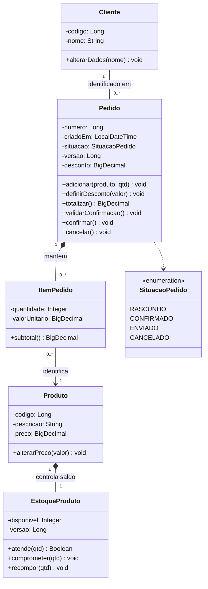

O saldo pertence exclusivamente ao produto nesta proposta. O preço do item é copiado do catálogo ao incluí-lo, para preservar o histórico. O rascunho pode estar vazio, mas a confirmação exige cliente e pelo menos um item. Os itens só podem ser modificados em `RASCUNHO`. O total é a soma de `quantidade * valorUnitario`, menos o desconto autorizado, limitado entre zero e o valor bruto.

**Contratos e implementação.**

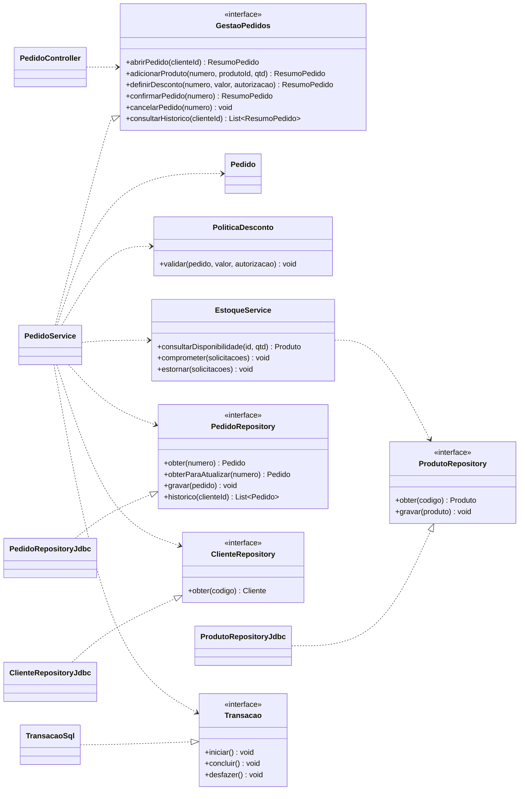

### Etapa 6

| Camada | Distribuição |
|---|---|
| Apresentação | Tela e controladores convertem a entrada para os DTOs de aplicação e transformam os resultados em respostas. |
| Aplicação | Serviços implementam os casos de uso e definem o limite transacional. `GestaoPedidos` é o contrato usado pela apresentação. |
| Domínio | Entidades, política comercial e contratos de repositório expressam o negócio. Os objetos não dependem do protocolo de entrada. |
| Infraestrutura | Repositórios Jdbc e `TransacaoSql` implementam acesso ao banco e atomicidade. Adaptadores de segurança fornecem a identidade autenticada. |

A apresentação conhece a aplicação; a aplicação conhece o domínio e seus contratos. A persistência depende dos contratos que implementa. A configuração liga as instâncias concretas às interfaces.

As camadas não obrigam uma cadeia única de chamadas ou de dependências. Por exemplo, o código Jdbc depende do contrato do domínio, mesmo sendo chamado pela aplicação em execução. O domínio não deve importar controladores, DTOs HTTP ou classes de conexão SQL.

### Etapa 7

```text
src/main/java/br/edu/sistema/
  cliente/
    web/
      ClienteController.java
      ClienteRequest.java
    aplicacao/
      ClienteService.java
      DadosCliente.java
    dominio/
      Cliente.java
      ClienteRepository.java
    persistencia/ClienteRepositoryJdbc.java
  produto/
    web/ProdutoController.java
    aplicacao/
      ProdutoService.java
      EstoqueService.java
      SolicitacaoEstoque.java
    dominio/
      Produto.java
      EstoqueProduto.java
      ProdutoRepository.java
    persistencia/ProdutoRepositoryJdbc.java
  pedido/
    web/
      PedidoController.java
      PedidoRequest.java
    aplicacao/
      GestaoPedidos.java
      PedidoService.java
      DadosPedido.java
      DadosItem.java
      ResumoPedido.java
    dominio/
      Pedido.java
      ItemPedido.java
      SituacaoPedido.java
      PoliticaDesconto.java
      PedidoRepository.java
    persistencia/PedidoRepositoryJdbc.java
  transacao/
    Transacao.java
    TransacaoSql.java
  configuracao/
    MontagemAplicacao.java
```

### Etapa 8

**Visão geral.** O sistema é organizado em módulos de cliente, produto e pedido. Cada registro começa como rascunho persistido e só compromete o estoque ao ser confirmado. Consultas de histórico acessam os pedidos gravados e seus preços originais.

**Decisões e justificativas.** O rascunho persistido permite continuar a composição sem manter uma transação de banco aberta durante a interação humana. Os contratos de repositório ficam no domínio e recebem implementações Jdbc. A aplicação depende de interfaces, permitindo testes com repositórios em memória. `Pedido` controla a composição dos itens; `EstoqueProduto` protege o saldo. Na confirmação, o controle de versão do pedido e do estoque evita atualizações concorrentes incompatíveis. O cancelamento de pedido confirmado e ainda não enviado recompõe o saldo na mesma transação da mudança de situação; cancelar rascunho não altera o estoque. Cancelamento repetido é rejeitado para não recompor o saldo duas vezes.

**Diretórios comentados.** Na etapa 7, `web` adapta a comunicação externa, `aplicacao` reúne os contratos de entrada e a coordenação, `dominio` contém as regras e as portas de repositório, e `persistencia` implementa SQL. `transacao` contém um contrato técnico e seu adaptador. `configuracao` monta a solução sem receber regras comerciais.

**Classes e diagramas.** A etapa 4 documenta as responsabilidades. A etapa 3 mostra a interação de abertura, composição e confirmação. A etapa 5 apresenta a estrutura do domínio e suas dependências de implementação.

**Rastreabilidade.**

| RN | RF e UC | Responsáveis |
|---|---|---|
| RN01. Associar cliente | RF01; UC01. | `PedidoService.abrirPedido()`, `ClienteRepository.obter()` e construção de `Pedido`. |
| RN02. Confirmar com itens | RF05 e RF07; UC01. | `Pedido.validarConfirmacao()` rejeita a coleção vazia. |
| RN03. Exigir estoque suficiente | RF04, RF05 e RF07; UC01. | Consulta por `EstoqueService`, validação em `Pedido.adicionar()` e comprometimento concorrente por `EstoqueProduto`. Quantidades repetidas são acumuladas por produto. |
| RN04. Somar subtotais e validar desconto | RF06; UC01. | `ItemPedido.subtotal()`, `Pedido.totalizar()` e `PoliticaDesconto.validar()`. |
| RN05. Bloquear alterações de itens confirmados | RF05 e RF07; UC01. | Operações de alteração de `Pedido` exigem situação `RASCUNHO`; a lista de itens não é exposta para alteração direta. |
| RN06. Impedir cancelamento após envio | RF08; UC02. | `Pedido.cancelar()` verifica a situação; a aplicação coordena eventual estorno e gravação. |

**Dependências entre módulos.** Pedido utiliza a consulta de clientes e o serviço público de estoque. Produto recebe apenas `SolicitacaoEstoque`, com identificador e quantidade, sem importar `ItemPedido`. Cliente e produto não dependem de pedido. Cada repositório concreto fica restrito ao seu módulo; outros módulos usam contratos. Ciclos entre módulos e acesso de entidades à infraestrutura são dependências a evitar.
